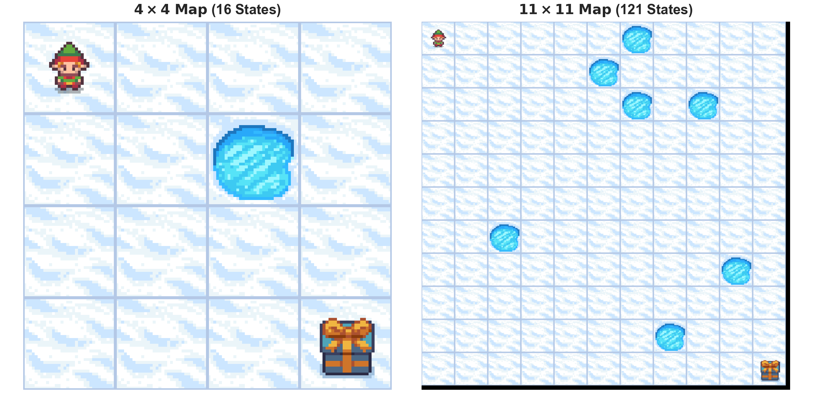
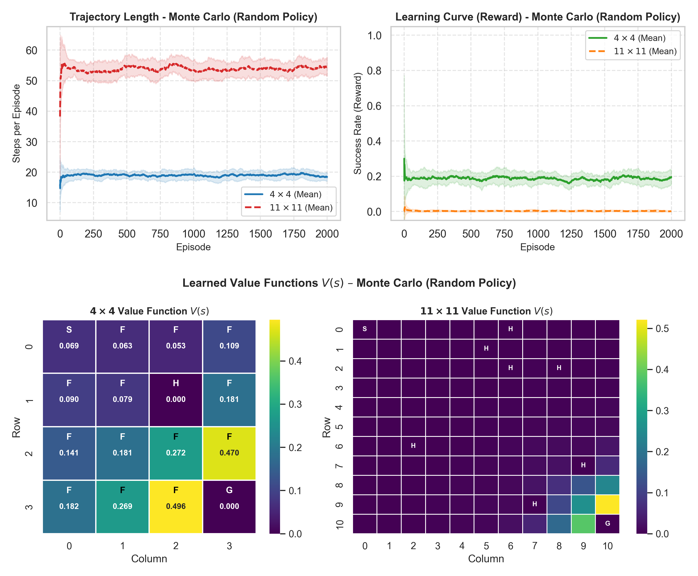
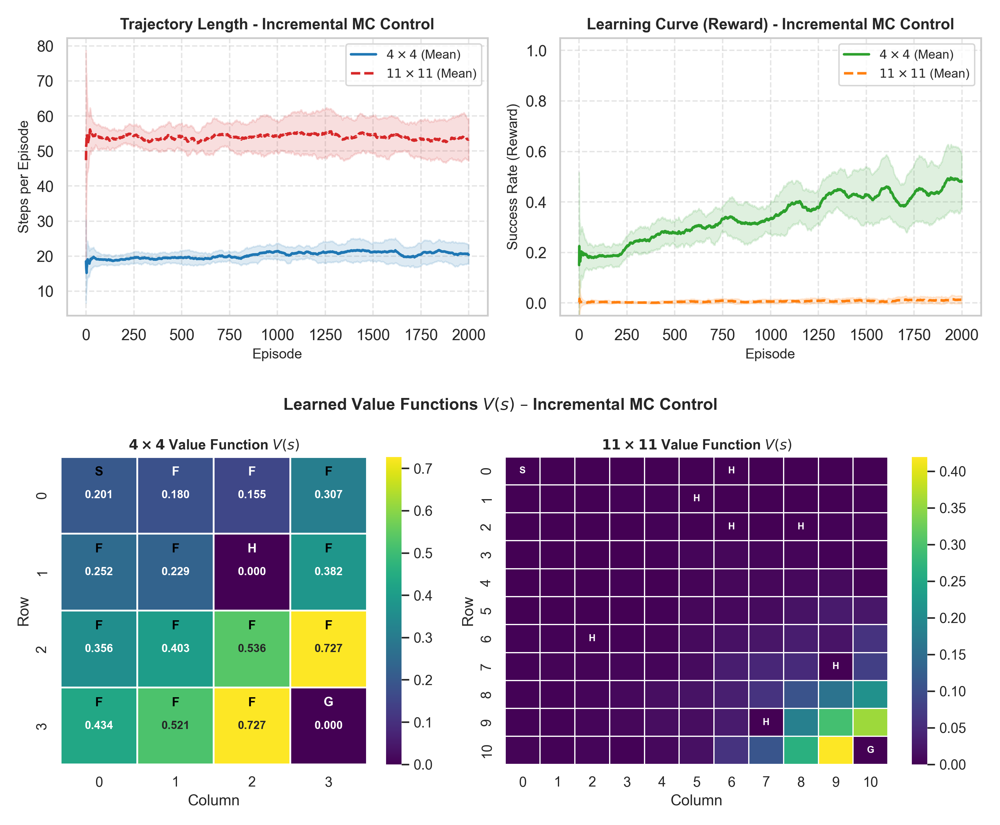
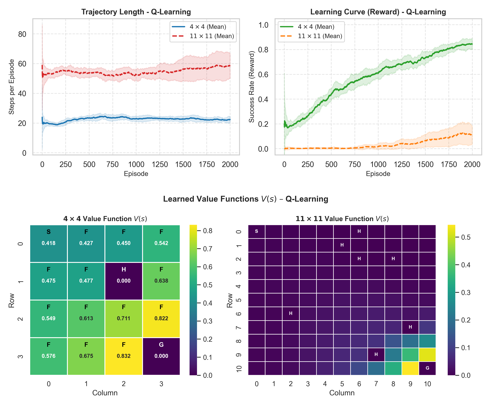
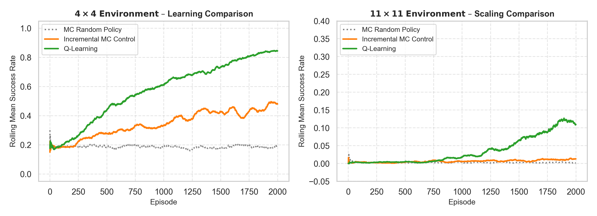

# Project Overview

In this graded lab, we implement and compare three model-free Reinforcement Learning methods on the Gymnasium `FrozenLake-v1` environment: Monte Carlo evaluation of a random policy (Task 1), Incremental Monte Carlo Control with $\varepsilon$-greedy exploration (Task 2) and Q-Learning (Task 3), each on a $4 \times 4$ and an $11 \times 11$ map. All figures and numbers in this report are generated by `generate_report_data_and_figures.py`; the notebook contains the step-by-step implementation of each method.

### Environment Configuration & Parameter Setup
All algorithms share the same environment and hyperparameter setup:

\rowcolors{2}{tabletint}{white}

| Parameter | Value | Description / Scope |
| :--- | :---: | :--- |
| `map_size` | $4 \times 4$ / $11 \times 11$ | Grid dimensions (16 discrete states vs. 121 states) |
| `is_slippery` | `True` | Stochastic transitions (1/3 intended, 2/3 orthogonal) |
| `proba_frozen` | 0.9 | Map generation: probability of frozen surface tiles |
| `total_episodes` | 2000 | Number of training episodes per run |
| `n_runs` | 20 | Independent runs on the same map, to average over stochastic transitions and action selection |
| `gamma` ($\gamma$) | 0.95 | Discount factor for future rewards |
| `alpha` ($\alpha$) | 0.1 | Fixed learning rate for incremental value updates |
| `epsilon_start` ($\varepsilon_0$) | 1.0 | Initial exploration rate |
| `epsilon_min` ($\varepsilon_{\min}$) | 0.05 | Minimum exploration floor (not reached within 2000 episodes) |
| `epsilon_decay_rate` | 0.001 | $\varepsilon_t = \max(\varepsilon_{\min}, \varepsilon_0 e^{-0.001\,t})$; $\varepsilon \approx 0.135$ after 2000 episodes |
| `seed` | 123 | Base random seed |

{width=75%}

### Hyperparameter Selection Approach
We started from the baseline configuration of the official Gymnasium FrozenLake tutorial (2000 episodes, 20 runs, $\gamma = 0.95$, `proba_frozen` = 0.9, seed 123) and adapted the parameters that are specific to our methods based on their role in the algorithms:

* **Fixed across all methods** (environment and evaluation setup): `map_size`, `is_slippery`, `proba_frozen`, `seed`, `total_episodes` and `n_runs` are identical for all three tasks, so that differences in the results can only come from the algorithms. 20 runs are used to report the mean and standard deviation of the stochastic learning curves.
* **Discount factor** $\gamma = 0.95$: the only reward is +1 at the goal. A value close to 1 keeps this reward visible over long trajectories (especially on $11 \times 11$), while $\gamma < 1$ still prefers reaching the goal sooner. $\gamma$ is the only learning parameter used in Task 1.
* **Learning rate** $\alpha = 0.1$: the tutorial value $\alpha = 0.8$ is designed for Q-Learning, where each update uses a single transition. For Monte Carlo, the target $G$ is a full return, which has a high variance on slippery ice; a large step size would let single lucky or unlucky episodes overwrite the estimate. We therefore chose a small constant $\alpha = 0.1$, which averages over roughly the last 10 returns, and use the same value for Q-Learning to keep the comparison fair.
* **Exploration schedule** ($\varepsilon_0 = 1.0$, decay 0.001, $\varepsilon_{\min} = 0.05$): the tutorial uses a constant $\varepsilon = 0.1$. Since all Q-values start at zero, the agent has no information at the beginning, so we start with pure exploration ($\varepsilon_0 = 1$) and let $\varepsilon$ decay exponentially so that the agent increasingly exploits its estimates. With a decay rate of 0.001, $\varepsilon$ falls to $\approx 0.37$ after 1000 and $\approx 0.135$ after 2000 episodes, so exploration continues throughout training, which is needed because rewards are sparse.

**Limitation:** the parameters were chosen by these considerations and not by a systematic search, and the same values were used for both control methods instead of tuning each one separately. A grid search over $\alpha$ and the decay rate (especially with more episodes on $11 \times 11$) would be a natural next step.
\newpage

# Task 1 – Monte Carlo with a Random Policy

### Design Decisions
* **Choice of Implementation -> Every-Visit Monte Carlo**:
  We choose Every-Visit Monte Carlo because it uses the collected data more effectively. On a slippery Frozen Lake, especially on the $11 \times 11$ grid, the agent falls into holes frequently and reaching the goal is rare. When the agent slips and visits the same state multiple times in one episode, First-Visit MC throws away all visits except the first one, whereas Every-Visit MC updates the state every time it is visited. This gives us more samples per episode, which matters when rewards are sparse.
  The trade-off is that the returns collected within one episode are correlated, so the Every-Visit estimator is biased for a finite number of episodes, whereas First-Visit MC uses independent samples and is unbiased. Both estimators are consistent and converge to $V^{\pi}$; given the sparse rewards, we accept the small bias in exchange for more samples per episode.

### Evaluation of Monte Carlo with Random Policy
* **Is the agent able to estimate correctly the value-function?**
  * **Yes, for the random policy.** The policy is fixed, so the sample averages converge to the true state-value function $V^{\pi}(s)$ of the uniform random policy (law of large numbers). The $4 \times 4$ heatmap is consistent with this: values increase towards the goal, and states from which a random walk often reaches the goal have the highest values. The flat learning curve only reflects that the policy itself does not change; it does not indicate that the value estimation fails. Note that this is the value of the *random* policy, not of the optimal policy.
* **Is the agent able to learn the right policy?**
  * **No.** In Task 1, we only perform policy evaluation, not policy improvement. Actions are sampled purely at random regardless of the estimated values, so the behaviour never improves.
* **Change the size of the environment to 11x11 and compare the learning process:**
  * Scaling to $11 \times 11$ increases the state space (121 states) and the distance to the goal. For a random policy, the probability of reaching the goal without falling into a hole drops to near zero (success rate $\approx 0$), and trajectories become longer (~54 steps). Almost all states have an estimated value close to 0, with clearly positive values only near the goal. This is not a failure of the estimator: under a random policy the true expected return from distant states is itself close to zero. States far from the goal are, however, estimated from very few successful returns, so their estimates are noisier than on the $4 \times 4$ map.

{width=66%}

\newpage

# Task 2 – Incremental Monte Carlo Control

### Design Decisions
* **Action-value representation**: We estimate action-values $Q(s, a)$ instead of state-values $V(s)$ to enable model-free control without transition probabilities; the greedy action is $\arg\max_a Q(s,a)$.
* **Incremental update**: Following slide 30, we replace the sample average of Task 1 by $Q(s,a) \leftarrow Q(s,a) + \alpha\,(G - Q(s,a))$ with a constant $\alpha = 0.1$. A constant step size is needed because the policy, and therefore the distribution of returns, changes during learning; recent returns are weighted more heavily than old ones generated by a worse policy.
* **Exploration strategy**: Exponentially decaying $\varepsilon$-greedy policy (see parameter table). Starting with pure exploration is necessary because all Q-values are initialized to zero, so greedy actions are meaningless at first; the slow decay keeps exploring throughout training because successful episodes, the only learning signal for Monte Carlo, are rare.
* **Every-Visit MC, initialization & tie-breaking**: Every-Visit MC as in Task 1; Q-values initialized to zero; random tie-breaking among maximal actions to avoid a directional bias early on.

### Evaluation of Incremental Monte Carlo Control
* **Is the agent able to estimate correctly the value-function?**
  * **Only partially.** Monte Carlo Control is on-policy: it estimates the value of the $\varepsilon$-greedy behaviour policy it follows, which still takes random actions with probability $\varepsilon \approx 0.14$ at the end of training, and not the value of the optimal policy. In addition, the constant step size and the small number of successful episodes make the estimates noisy. The values therefore underestimate the optimal values: the start state reaches only $\approx 0.20$, about half of the value learned by Q-Learning ($\approx 0.42$, Task 3), although both agents act on the same map.
* **Is the agent able to learn the right policy?**
  * **Partially.** The agent clearly improves over random behaviour: the training success rate rises from roughly 20% to nearly 50%, compared to ~19% for the random policy. Since this rate is measured with the exploring $\varepsilon$-greedy policy, the purely greedy policy is likely to perform better. However, the success rate is still clearly below that of Q-Learning on the same map, so the learned policy is not yet optimal after 2000 episodes. Trajectory lengths increase slightly to around 20 to 21 steps (see final discussion).
* **Change the size of the environment to 11x11 and compare the learning process:**
  * On the $11 \times 11$ grid, Incremental Monte Carlo does not learn within the budget of 2000 episodes: the success rate stays at essentially 0% and trajectories average around 55 steps. Because Monte Carlo needs a complete successful episode to register any reward, the agent almost never gets a learning signal, and the heatmap shows positive values only right next to the goal. Monte Carlo would still converge in principle, but it needs far more episodes than are available here.

{width=58%}

\newpage

# Task 3 – Q-Learning Integration

### Design Decisions
* **Hyperparameter consistency**: We use exactly the same hyperparameters as in Task 2 ($\alpha = 0.1$, $\gamma = 0.95$, same $\varepsilon$-decay schedule), so that differences between the two methods can be attributed to the update rule (bootstrapped one-step TD target vs. full Monte Carlo return) and not to different hyperparameters.
* **Initialization and tie-breaking**: Same as in Task 2.

### Evaluation of Q-Learning
* **Is the agent able to estimate correctly the value-function?**
  * **Yes on $4 \times 4$, not yet on $11 \times 11$.** Q-Learning is off-policy: its target $r + \gamma \max_{a'} Q(s',a')$ uses the best next action, so it estimates the optimal action-values $Q^*$ independently of the exploration. On $4 \times 4$, the values form a consistent gradient from the start ($\approx 0.42$) to around 0.82 next to the goal and are clearly higher than those of Monte Carlo Control, which only estimates the value of the exploring policy. On $11 \times 11$, the values have not converged after 2000 episodes (see below).
* **Is the agent able to learn the right policy?**
  * **Yes on $4 \times 4$.** The training success rate climbs from around 15% to over 80%, although the agent still takes a random action with probability $\varepsilon \approx 0.14$; the greedy policy alone is therefore expected to perform even better. This is clearly better than Monte Carlo Control on the same map. On $11 \times 11$, the policy is not yet learned (training success rate of 12% to 15%).
* **Change the size of the environment to 11x11 and compare the learning process:**
  * While Monte Carlo stayed flat at about 0%, Q-Learning starts learning, reaching a training success rate of around 12% to 15% by the end. Through bootstrapping, each state can learn from the value of its neighbour instead of needing a complete successful episode, so the value signal propagates backwards from the goal. However, the learning has not converged after 2000 episodes: clearly positive values are still concentrated around the goal, and the values near the start remain close to zero.

{width=72%}

\newpage

# Comparative Analysis & Algorithm Benchmark

{width=85%}

\rowcolors{2}{tabletint}{white}

| Algorithm | 4x4 Training Success Rate | 11x11 Training Success Rate | Update Frequency |
| :--- | :---: | :---: | :--- |
| **Monte Carlo (Random Policy)** | ~19% | ~0.2% | Episodic (Every-Visit) |
| **Incremental Monte Carlo Control** | ~47% | ~1.1% | Episodic rollout ($Q$-values) |
| **Q-Learning** | **~84%** | **~12%** | Step-by-step (1-step TD bootstrap) |

*Training success rate = mean reward over the last 200 training episodes, averaged over 20 runs, measured with the $\varepsilon$-greedy behaviour policy.*

---

# General Discussion & Conclusion

* **Monte Carlo with a Random Policy (Task 1)** is pure policy evaluation: it correctly estimates the value of the random policy, but by design it cannot improve the behaviour.
* **Incremental Monte Carlo Control (Task 2)** turns evaluation into control by acting $\varepsilon$-greedily on the learned Q-values. It learns a useful policy on $4 \times 4$, but as an on-policy method it estimates the value of the exploring policy, and because it needs complete successful episodes to learn anything, it does not learn on $11 \times 11$ within 2000 episodes.
* **Q-Learning (Task 3)** performed best on both maps. Its off-policy target estimates the optimal values directly, and its one-step bootstrapped updates propagate the reward backwards without requiring complete successful episodes, which is decisive when rewards are sparse. Within 2000 episodes, however, neither control method converged on $11 \times 11$; a fair comparison of final performance there would require considerably more episodes.

### Why Longer Trajectories Indicate Better Learning
Longer episodes do not indicate poor learning. An untrained agent often falls into a hole early, while a trained agent survives longer: on slippery ice, safe detours are needed to avoid sliding into a hole, so the trajectory length levels off at around 20 to 24 steps on $4 \times 4$, well above the shortest path of 6 steps. Although $\gamma = 0.95$ favours shorter paths, a hole costs the entire future reward, so a safe detour is worth more than a short risky path.
