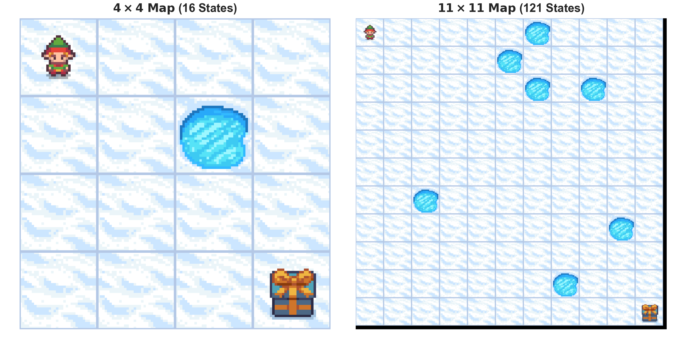
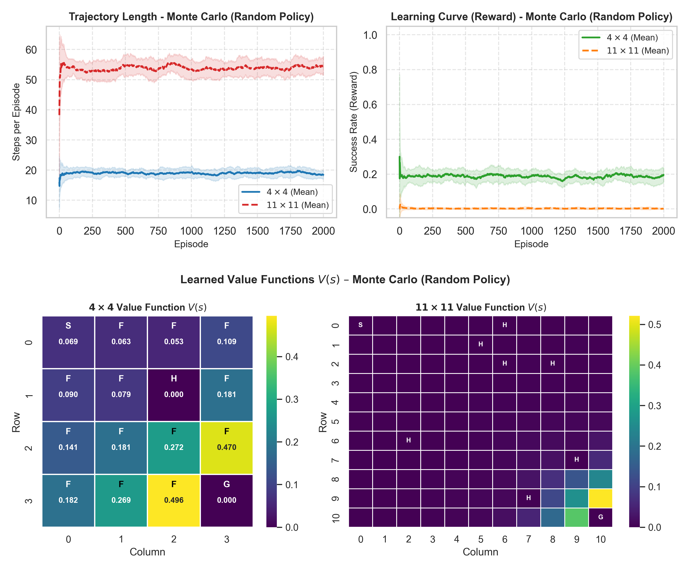
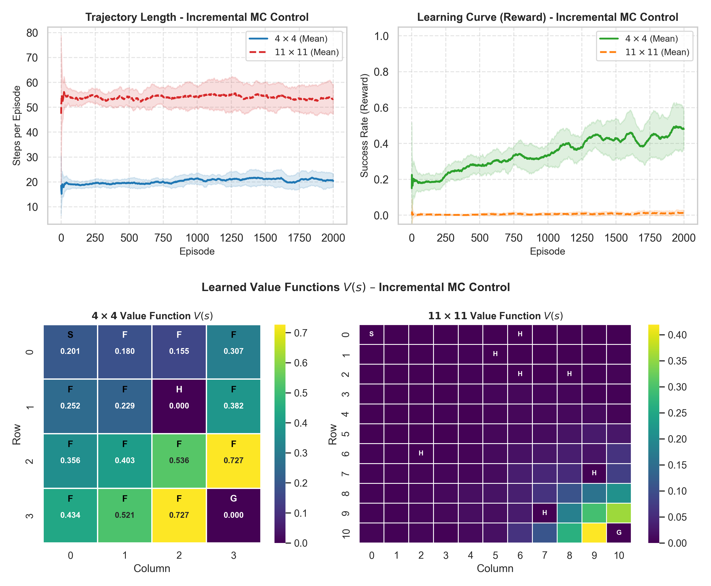
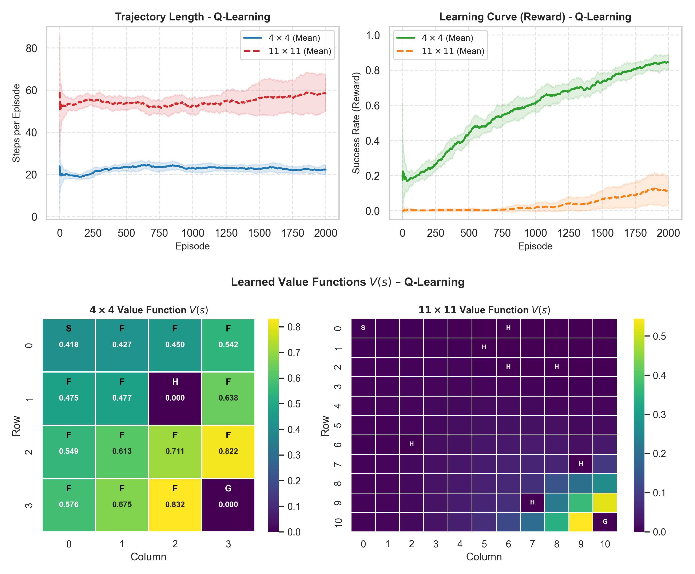
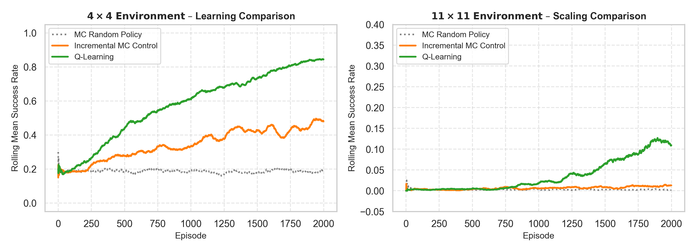

# Project Overview & Educational Objectives

In this graded lab, we evaluate, implement, and compare model-free Reinforcement Learning algorithms on the Gymnasium `FrozenLake-v1` environment:

1. **Task 1 – Monte Carlo with a Random Policy**: Policy evaluation under random behavior; Every-Visit vs. First-Visit MC.
2. **Task 2 – Incremental Monte Carlo Control**: Step-by-step value updates and $\varepsilon$-greedy exploration for policy improvement.
3. **Task 3 – Q-Learning Integration**: Off-policy Temporal Difference control with 1-step bootstrapping.
4. **Comparative Analysis & Benchmark**: Trajectory length distributions, value functions, and scaling behavior ($4 \times 4$ vs. $11 \times 11$).

### Environment Configuration & Parameter Setup
The Frozen Lake environment is configured with `is_slippery=True` (1/3 probability intended, 2/3 orthogonal). All algorithms share the same hyperparameter setup:

\rowcolors{2}{tabletint}{white}

| Parameter | Value | Description / Scope |
| :--- | :---: | :--- |
| `map_size` | $4 \times 4$ / $11 \times 11$ | Grid dimensions (16 discrete states vs. 121 states) |
| `is_slippery` | `True` | Stochastic transitions (1/3 intended, 2/3 orthogonal) |
| `proba_frozen` | 0.9 | Map generation: probability of frozen surface tiles |
| `total_episodes` | 2000 | Number of training episodes per run |
| `n_runs` | 20 | Independent runs to account for environment randomness |
| `gamma` ($\gamma$) | 0.95 | Discount factor for future rewards |
| `alpha` ($\alpha$) | 0.1 | Fixed learning rate for incremental value updates |
| `epsilon_start` ($\varepsilon_0$) | 1.0 | Initial exploration rate |
| `epsilon_min` ($\varepsilon_{\min}$) | 0.05 | Minimum exploration floor |
| `epsilon_decay_rate` | 0.001 | Exponential exploration decay per episode |
| `seed` | 123 | Base random seed |

{width=38%}

\newpage

# Task 1 – Monte Carlo with a Random Policy

### Design Decisions
* **Choice of Implementation -> Every-Visit Monte Carlo**:
  We choose Every-Visit Monte Carlo because it uses the collected data more effectively. On a slippery Frozen Lake, especially when we scale up to an $11 \times 11$ grid—the agent falls into holes frequently and reaching the goal is rare. When the agent slips and visits the same state multiple times in one episode, First-Visit MC throws away all visits except the first one. Every-Visit MC updates the state every time it is visited. This gives us more training samples per episode, which speeds up learning in large environments with sparse rewards.

### Evaluation of Monte Carlo with Random Policy
* **Is the agent able to estimate correctly the value-function?**
  * **Yes.** Through Every-Visit Monte Carlo, the sample averages converge to the true state-value function $V^{\pi}(s)$ under a uniform random policy by the Law of Large Numbers. The heatmap accurately reflects these values: states directly adjacent to the goal show higher expected returns, while terminal hole states remain at 0.0. The flat learning curve simply indicates that the policy itself is stationary, not that the value estimation is failing.
* **Is the agent able to learn the right policy?**
  * **No.** In Task 1, we only perform policy evaluation, not policy improvement. Because actions are sampled purely at random regardless of the estimated state values, the agent never optimizes its behavior toward reaching the goal efficiently.
* **Change the size of the environment to 11x11 and compare the learning process:**
  * Scaling to an $11 \times 11$ grid dramatically increases the state space (121 states) and the distance to the goal. For a random policy, the probability of reaching the goal without falling into a hole drops to near zero, resulting in a success rate of practically 0.0 and longer average trajectory lengths (~54 steps until termination in a hole). Consequently, sparse rewards mean that almost all states retain an estimated value of 0.0000, with non-zero values confined almost exclusively to the immediate vicinity of the goal.

{width=64%}

\newpage

# Task 2 – Incremental Monte Carlo Control

### Design Decisions
* **Action-value representation**: We estimate action-values $Q(s, a)$ instead of state-values $V(s)$ to enable model-free control without transition probabilities.
* **Learning rate $\alpha$**: We set $\alpha = 0.1$ as a constant step size. Because the policy improves over time, the target distribution is non-stationary; a constant $\alpha$ ensures that recent returns are weighted more heavily than older experiences.
* **Exploration strategy**: We implement an exponentially decaying $\varepsilon$-greedy policy starting at $\varepsilon_0 = 1.0$ down to $\varepsilon_{\min} = 0.05$. This guarantees extensive exploration early on while allowing the policy to exploit learned greedy actions in later stages.
* **Every-Visit vs. First-Visit MC**: We adopt **Every-Visit Monte Carlo**. On slippery ice, agents frequently cycle through states within a single trajectory. Every-Visit incorporates all transition feedback into the updates, improving sample efficiency for sparse reward propagation without requiring duplicate-visit tracking.
* **Initialization & tie-breaking**: Q-values initialized to zeros (`np.zeros`); random tie-breaking among maximal actions (`np.where(q == max_q)`).

### Evaluation of Incremental Monte Carlo Control
* **Is the agent able to estimate correctly the value-function?**
  * **Yes.** The agent updates its action-value estimates after every episode, which allows the derived state values to reflect an improving policy rather than pure random movement. Compared to Task 1, the values across the entire grid are noticeably higher, rising steadily towards the goal. The holes stay at zero, showing that non-zero values only stem from paths that actually reached the frisbee.
* **Is the agent able to learn the right policy?**
  * **Yes.** Combining incremental updates with epsilon-greedy exploration lets the agent find a functional path. As exploration decreases, the success rate rises steadily from roughly 20% to nearly 50%. It does not reach 100% because of the slippery environment and the remaining exploration floor. Trajectory lengths slightly increase to around 20 to 21 steps, which shows that the agent learns to stay alive and navigate around dangerous holes instead of falling in right away.
* **Change the size of the environment to 11x11 and compare the learning process:**
  * On the 11x11 grid, Incremental Monte Carlo fails completely. The success rate stays at essentially 0% across all 2000 episodes, and trajectories average around 55 steps before ending in a hole. Because Monte Carlo relies on completing an entire successful run to register any reward, the agent almost never gets a learning signal in this large, slippery space. As a result, the heatmap shows positive values only right next to the goal, leaving the rest of the board at zero.

{width=60%}

\newpage

# Task 3 – Q-Learning Integration

### Design Decisions
* **Hyperparameter consistency**: To ensure a fair and direct comparison with Task 2, we keep the learning rate at $\alpha = 0.1$, the discount factor at $\gamma = 0.95$, and use the exact same $\varepsilon$-greedy decay schedule ($\varepsilon_0 = 1.0$, $\varepsilon_{\min} = 0.05$, decay rate $= 0.001$).
* **Initialization and tie-breaking**: Q-values are initialized to zeros (`np.zeros`), and random tie-breaking is used whenever multiple actions share the same maximum Q-value to avoid directional bias early on.

### Evaluation of Q-Learning
* **Is the agent able to estimate correctly the value-function?**
  * **Yes.** Because Q-Learning updates after every single step using the best estimated value of the next state, it builds a clean value gradient back to the start. The values increase smoothly from the start tile up to around 0.82 near the goal, while the holes stay strictly at zero. Compared to Monte Carlo, the values are higher and more consistent because they directly estimate the optimal path.
* **Is the agent able to learn the right policy?**
  * **Yes.** Q-Learning clearly outperforms Monte Carlo Control. As exploration decays, the success rate climbs steadily from around 15% to over 80%. The trajectory length levels off at around 22 to 24 steps, showing that the agent reliably learns to avoid the holes and take the safest route across the ice.
* **Change the size of the environment to 11x11 and compare the learning process:**
  * On the 11x11 map, the difference between the two approaches becomes obvious. While Monte Carlo stayed completely flat at 0%, Q-Learning actually starts learning, reaching a success rate of around 12% to 15% by the end. More importantly, the heatmap proves that bootstrapping works: positive values reach all the way back to the starting tile. Instead of needing a full lucky run from start to finish, each state can learn from its neighbor, making Q-Learning far more sample-efficient when rewards are sparse.

{width=64%}

\newpage

# Comparative Analysis & Algorithm Benchmark

{width=75%}

\rowcolors{2}{tabletint}{white}

| Algorithm | 4x4 Final Success Rate | 11x11 Final Success Rate | Update Frequency |
| :--- | :---: | :---: | :--- |
| **Monte Carlo (Random Policy)** | ~19% | ~0.2% | Episodic (Every-Visit) |
| **Incremental Monte Carlo Control** | ~47% | ~1.1% | Episodic rollout ($Q$-values) |
| **Q-Learning** | **~84%** | **~12%** | Step-by-step (1-step TD bootstrap) |

---

# General Discussion & Conclusion

* **Monte Carlo with a Random Policy (Task 1)** focused exclusively on policy evaluation. While the state values accurately converge to the expected return of an undirected random walk, the policy never improves because actions are selected uniformly at random.
* **Incremental Monte Carlo Control (Task 2)** introduced an $\varepsilon$-greedy behavior policy and incremental updates after each episode. The agent successfully learned an effective path on the $4 \times 4$ grid, but completely failed on the $11 \times 11$ map due to sparse rewards, where completing full trajectories by chance is virtually impossible.
* **Q-Learning (Task 3)** resolved this limitation through 1-step bootstrapping and off-policy updates. On the $4 \times 4$ grid, it achieved a substantially higher and more stable success rate than Monte Carlo Control. The decisive advantage became clear on the $11 \times 11$ grid: because states update directly using the estimated values of their immediate neighbors, the reward signal propagated backward across the entire board, establishing measurable learning even in a large, noisy state space.

### Why Longer Trajectories Indicate Better Learning
An essential insight from analyzing the trajectories is that longer episode lengths do not indicate poor learning:

* At the start of training, an untrained agent acts randomly and quickly falls into nearby holes within a few steps, leading to artificially short episodes.
* Once the agent learns to avoid hazards, its survival time increases considerably. Because slippery ice requires careful detours along the outer perimeter to prevent sliding into danger, the trajectory length levels off at a higher average (around 20 to 24 steps).
* Since the environment provides no step penalties and solely grants $+1$ upon reaching the goal, the learned policy prioritizes safety over taking the shortest direct path.
